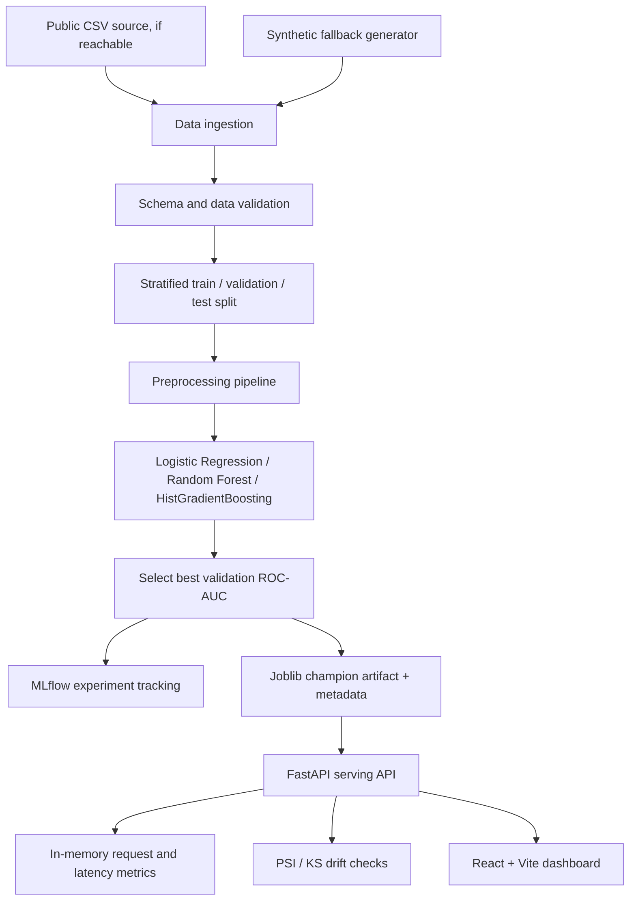

# ModelFlow MLOps

ModelFlow MLOps is a machine-learning engineering portfolio project for a binary customer-churn prediction workflow. It brings together data preparation, model comparison, experiment tracking, model packaging, API inference and basic drift/serving telemetry.

The project uses tabular customer-service data and scikit-learn models. It is intended to demonstrate an end-to-end ML workflow; it is not a production customer-retention system and has not been validated on a live telecom customer base.

## Hosted application

The repository is configured with a Vercel frontend and a Render FastAPI service:

- **Frontend dashboard:** [model-flow-mlops.vercel.app](https://model-flow-mlops.vercel.app)
- **Backend API documentation:** [model-flow-mlops.onrender.com/docs](https://model-flow-mlops.onrender.com/docs)
- **Backend health endpoint:** [model-flow-mlops.onrender.com/health](https://model-flow-mlops.onrender.com/health)

The frontend is configured to call the Render service through `VITE_API_BASE_URL`. Hosted availability may vary with the deployment plan and service state; use the health endpoint to check the API before a demonstration.

## What the project demonstrates

- **Data ingestion and validation:** attempts to retrieve the Telco Customer Churn CSV used by IBM's sample; if that request fails, the current ingester generates synthetic data with a similar schema and a seeded churn-generation process.
- **Preprocessing:** handles numeric and categorical fields in a scikit-learn `ColumnTransformer`, including median/mode imputation, standard scaling and one-hot encoding.
- **Model comparison:** trains Logistic Regression, Random Forest and HistGradientBoosting candidates using class-weighted classifiers.
- **Experiment tracking:** records candidate runs, parameters and metrics in MLflow.
- **Artifact creation:** saves the selected scikit-learn pipeline with Joblib and writes model metadata.
- **Inference API:** serves single-record and batch predictions through FastAPI, with churn probability, a risk tier and a suggested follow-up message.
- **Monitoring demonstration:** collects in-memory request metrics and compares recent feature distributions against a reference dataset using PSI and, for numeric features, the two-sample Kolmogorov–Smirnov test.
- **Reproducible workflow definition:** includes DVC stages and GitHub Actions checks.

## Architecture



For more detail, see:
- [Architecture and request flow](docs/architecture.md)
- [Data provenance and reproducibility](docs/data-and-reproducibility.md)
- [Evaluation and monitoring](docs/model-evaluation.md)

## Model development workflow

The pipeline is configured in `params.yaml` and defined as five DVC stages in `dvc.yaml`:

1. Ingest the raw dataset or generate the synthetic fallback.
2. Validate the schema, clean fields and create stratified 70% / 15% / 15% splits.
3. Train three candidate classifiers and log their training/validation metrics.
4. Evaluate the selected model on the held-out test split.
5. Compare the test split with the training reference distribution for a drift demonstration.

The selected model is the candidate with the highest validation ROC-AUC. The configured minimum ROC-AUC value is currently a **warning threshold**, not a hard deployment block: the training code still writes the champion artifact when the score is below it. See [model evaluation](docs/model-evaluation.md).

## Stored evaluation artifact

The committed `artifacts/reports/evaluation_metrics.json` currently records the following held-out test report:

| Metric | Stored result |
| --- | ---: |
| Accuracy | 0.7474 |
| Precision (Churn = Yes) | 0.5165 |
| Recall (Churn = Yes) | 0.7794 |
| F1 score | 0.6213 |
| Macro F1 | 0.7159 |
| ROC-AUC | 0.8447 |
| PR-AUC | 0.6587 |
| Test records | 1,057 |

The report's confusion matrix is:

| | Predicted: No churn | Predicted: Churn |
| --- | ---: | ---: |
| **Actual: No churn** | 571 | 205 |
| **Actual: Churn** | 62 | 219 |

These values are copied from the committed evaluation JSON, not newly generated during this documentation update. The repository's ingestion path can use either a downloaded CSV or synthetic fallback data, and the committed report does not record which path produced it. Until that provenance is captured for the specific run, do not describe these figures as a verified result on IBM's original dataset or on real customer data.

## Dataset and features

The target is `Churn` (Yes/No). The configured feature set contains:

- **Numeric:** `tenure`, `MonthlyCharges`, `TotalCharges`
- **Categorical:** customer profile, service, contract and payment attributes listed in `params.yaml`

The current split configuration is stratified and uses random seed 42. See [data provenance and reproducibility](docs/data-and-reproducibility.md) for the source/fallback distinction and the DVC limitations.

## API

The FastAPI application is defined in `api/main.py`. Interactive Swagger documentation is available at `/docs` when the service is running.

| Method | Endpoint | Purpose |
| --- | --- | --- |
| GET | `/` | Service index |
| GET | `/health` | Liveness / service status |
| GET | `/health/ready` | Checks whether the model can be loaded |
| GET | `/model` | Model metadata |
| GET | `/model/features` | Expected numeric and categorical feature names |
| POST | `/predict` | Single-customer churn prediction |
| POST | `/predict/batch` | Batch prediction (up to 1,000 records) |
| GET | `/metrics` | In-memory request and latency summary |
| GET | `/monitoring/drift` | Drift check on recent buffered inferences, with a saved-report/test-split fallback |
| GET | `/experiments` | Evaluation report and available MLflow runs |

The API can start in standby mode if the model artifact is missing. In that case, the liveness route can still respond while the readiness route reports that the model is unavailable.

## Local setup

### 1. Create an environment and install backend dependencies

Use Python 3.12:

```bash
python -m venv .venv

# Windows PowerShell
.venv\Scripts\Activate.ps1

# macOS / Linux
source .venv/bin/activate

python -m pip install --upgrade pip
pip install -r requirements.txt
```

### 2. Run the ML pipeline

From the repository root:

```bash
python scripts/run_pipeline.py
```

This runs ingestion, validation/splitting, candidate training, test evaluation and drift analysis. The first run may need network access to fetch the configured CSV. If the request fails, the current implementation generates synthetic benchmark data instead. Review the logs and resulting data before reporting any metric.

DVC stage execution is also defined:

```bash
dvc repro
```

The repository currently has no configured DVC remote, so DVC cache/data reproduction is local unless you configure a remote yourself. See [data provenance and reproducibility](docs/data-and-reproducibility.md).

### 3. Start the API

```bash
uvicorn api.main:app --host 0.0.0.0 --port 8000 --reload
```

Open [http://localhost:8000/docs](http://localhost:8000/docs).

### 4. Start the frontend

In a second terminal:

```bash
cd frontend
npm ci
```

Create `frontend/.env.local`:

```env
VITE_API_BASE_URL=http://localhost:8000
```

Then run:

```bash
npm run dev
```

The Vite development server is available at [http://localhost:5173](http://localhost:5173).

## Tests and code quality

Run backend tests and linting from the repository root:

```bash
pytest tests/ -v --tb=short
ruff check src api tests scripts
```

Build/lint the frontend from `frontend/`:

```bash
npm run lint
npm run build
```

The GitHub Actions workflow also runs the pipeline, test suite and Docker build. No claim is made here that these checks were executed as part of this documentation update; use the current Actions run for the latest result.

## CI/CD workflow

GitHub Actions is configured in `.github/workflows/ci_cd.yml`. The workflow is intended to:

1. Run backend Ruff linting.
2. Run the data pipeline, backend tests and originality check.
3. Run frontend linting and a production Vite build.
4. Build the Docker image and smoke-test its API endpoints.
5. Trigger Render deployment on a push to `main`, after the validation jobs pass and when `RENDER_DEPLOY_HOOK_URL` is configured.

The previous Docker build failure was caused by the churn target retaining a pandas string dtype before a mean calculation. The current review branch adds dtype-independent target normalisation, regression tests and fail-fast shell handling for piped commands. The updated CI result is the source of truth for whether the fix has passed; do not treat the pipeline as green until the new GitHub Actions run completes successfully.

## Docker

The multi-stage Dockerfile runs the complete ML pipeline during the **image build** before assembling the serving image. This means a Docker build can take time, install the training dependencies, attempt a dataset download or use the synthetic fallback, and generate model artifacts. It is not just a lightweight packaging step.

```bash
docker compose up --build
```

The Compose file starts the API and a separate MLflow service. There is a configuration detail to review before relying on remote MLflow tracking in Compose: the training registry and experiments route currently read the tracking URI from `params.yaml`, while Compose supplies `MLFLOW_TRACKING_URI` through the environment. Verify that the URI actually used by the code matches the intended MLflow service before presenting this as a connected remote tracking setup.

## Current limitations and next engineering steps

- **Dataset provenance:** the ingestion code does not currently write a manifest saying whether a run used the downloaded CSV or synthetic fallback.
- **DVC sharing:** no remote is configured in `.dvc/config`; DVC cache is local to the machine until a remote is set up.
- **Promotion threshold:** the ROC-AUC threshold currently logs a warning but does not prevent champion artifact creation.
- **MLflow integration:** the default tracking URI comes from `params.yaml`; reconcile this with environment-based Compose configuration before relying on the separate tracking service.
- **Drift monitoring:** recent inference samples are buffered in memory (up to 1,000 records) and reset when the API process restarts. It is a project demonstration, not persistent production observability.
- **Deployment CORS:** replace wildcard origins with the specific frontend origin(s) before exposing a hosted API.
- **Docker build cost:** training during image build can make builds slower and dependent on the current data source; a later improvement could separate model training/artifact creation from serving-image construction.

These limitations are useful follow-up engineering work and should be explained honestly in a technical discussion.

## Licence

The repository code is licensed under Apache-2.0; see [LICENSE](LICENSE). This does not automatically establish the licence of any external dataset downloaded by the ingestion script.
