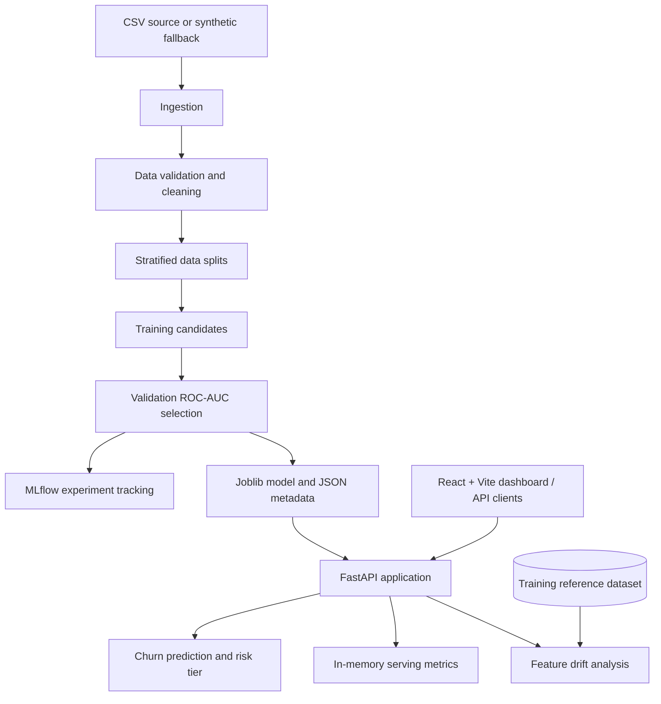

# Architecture and request flow

This document describes the current ModelFlow implementation based on the repository source. It is a portfolio-project architecture guide, not a production architecture certification.

## System overview

## Main components

| Path | Responsibility |
| --- | --- |
| `src/data/ingest.py` | Attempts to fetch the configured Telco churn CSV; generates synthetic benchmark data if the request fails |
| `src/data/validator.py` | Checks required columns, missing values, numeric ranges and target values |
| `src/data/loader.py` | Cleans fields, converts the target to 0/1 and creates stratified data splits |
| `src/features/preprocessor.py` | Builds numeric and categorical transformations |
| `src/training/pipeline.py` | Creates scikit-learn pipelines for the candidate classifiers |
| `src/training/trainer.py` | Trains candidates, compares validation metrics and selects the highest primary-metric score |
| `src/training/registry.py` | Logs runs to MLflow and saves the selected pipeline and metadata locally |
| `src/evaluation/evaluator.py` | Evaluates the selected pipeline on the held-out test split and writes diagnostic artifacts |
| `src/serving/manager.py` | Loads the Joblib pipeline and metadata into the API process |
| `src/serving/predictor.py` | Produces class predictions, churn probability, risk tier and recommendation text |
| `src/monitoring/metrics_collector.py` | Keeps recent request/latency/prediction information in a bounded in-memory buffer |
| `src/monitoring/drift.py` | Calculates PSI for features and KS statistics for numeric features |
| `api/routes/` | FastAPI endpoints for health, model information, predictions and monitoring |
| `frontend/src/` | React dashboard for predictions, model, experiments and system views |

## Training and model selection

The current pipeline compares three class-weighted scikit-learn classifiers:

- Logistic Regression
- Random Forest
- HistGradientBoosting

Numeric fields are median-imputed and standardised. Categorical fields are imputed with the most frequent value and one-hot encoded.

Training metrics are logged for each candidate, while the primary candidate-selection metric is configured in `params.yaml` (currently `roc_auc`). The code selects the highest validation score. The configured minimum score is used to log a warning if the threshold is not met; it does not currently stop the pipeline from saving the champion.

The Logistic Regression candidate is a standard class-weighted `LogisticRegression` pipeline. The source does not currently wrap it in a probability-calibration estimator.

## API request flow

A single-record prediction follows this path:

1. A client sends a JSON body to `POST /predict`.
2. FastAPI validates it using the `CustomerFeatures` Pydantic schema.
3. The route converts the schema to a dictionary and calls `predictor.predict_single`.
4. The predictor builds a one-row DataFrame and runs the saved scikit-learn pipeline.
5. It returns the predicted class, probability of churn, confidence, risk tier, recommendation text, model metadata and inference latency.
6. Operational counters and recent features are recorded in memory.

The class decision currently uses a probability threshold of 0.50. Risk-tier labels use separate thresholds: High Risk at 0.65 or above, Medium Risk from 0.35 to below 0.65, and Low Risk below 0.35. These are project rules, not validated business intervention thresholds.

The batch route processes a list of customer payloads and returns per-record predictions plus aggregate counts.

## Health and readiness

- `GET /health` is a liveness-style endpoint. It returns service status and indicates whether the model is loaded.
- `GET /health/ready` attempts to load the model if necessary and returns HTTP 503 if the model is unavailable.

The application can start in standby mode if model loading fails. A successful liveness response therefore does not necessarily mean prediction requests are ready.

## Monitoring behaviour

### Operational metrics

The `MetricsCollector` is thread-safe but process-local. It retains up to 1,000 recent inference records in memory, plus counters and latency samples. This is suitable for a project dashboard but does not persist data across process restarts and is not a Prometheus exporter.

### Drift checks

The drift implementation:
- Uses PSI for numerical and categorical fields.
- Also uses the two-sample Kolmogorov–Smirnov test for numerical fields.
- Does not currently run a Chi-Square test for categorical features.
- Sets the overall drift alert only when at least 30% of analysed features are individually flagged.

The API checks recent inference records when at least ten buffered records are available. Otherwise, it may return the saved report or compare the test split with the training reference. The saved report is a recorded run, not continuous production monitoring.

## Tracking and persistence

The training registry logs model runs and metrics to MLflow and saves the selected model via Joblib. The project does not currently use the official MLflow Model Registry API for staged model lifecycle transitions.

The default tracking URI is read from `params.yaml`. The Compose file also launches a separate MLflow service and supplies an environment variable for the tracking URI, but the current training registry and experiments route read the YAML setting directly. Align these paths before assuming Compose routes all MLflow traffic through the separate service.

For data-source and reproduction details, see [Data provenance and reproducibility](data-and-reproducibility.md).
